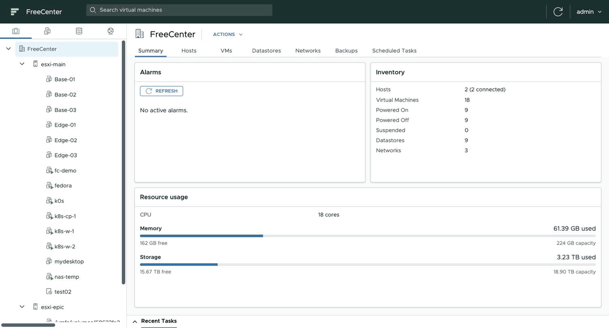
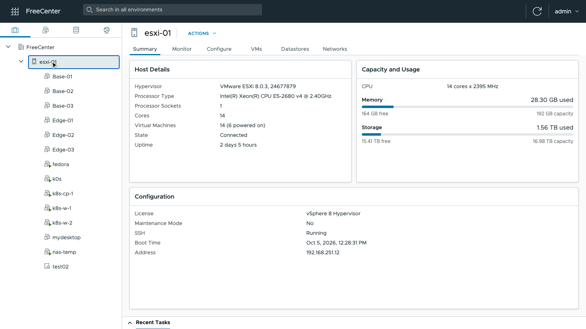
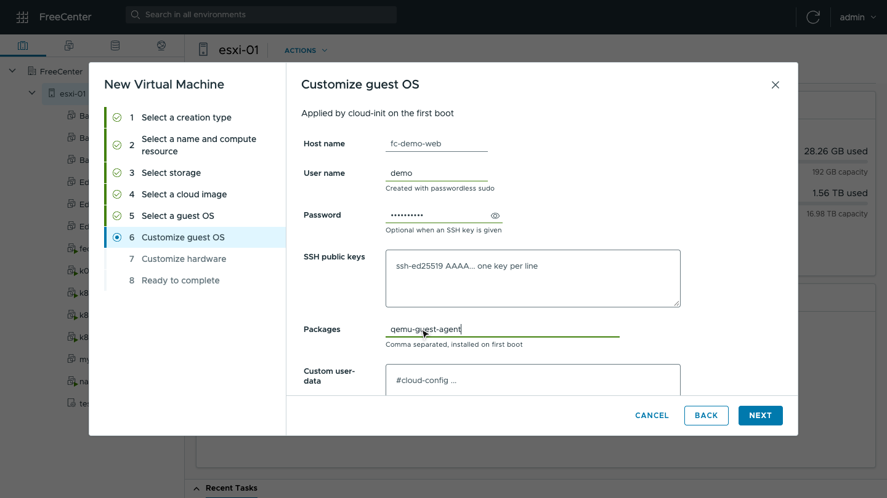
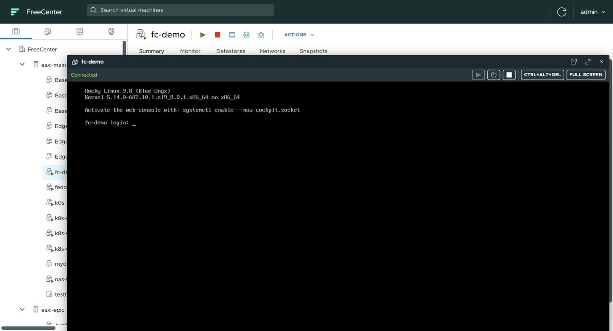
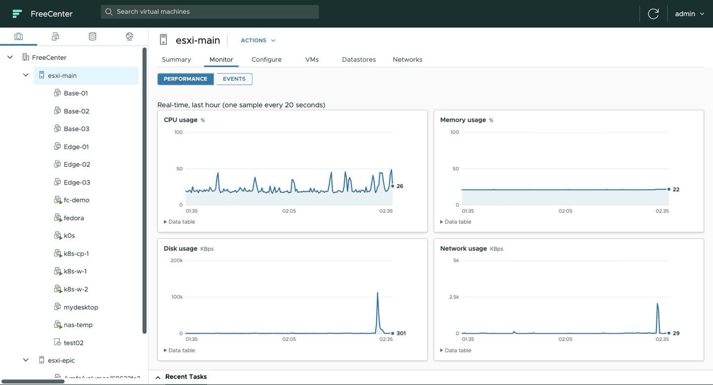
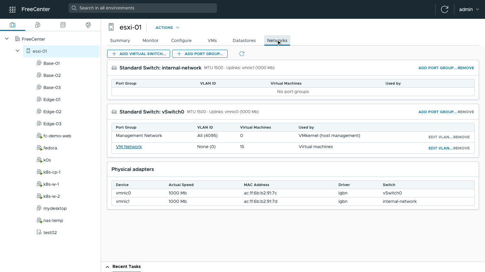
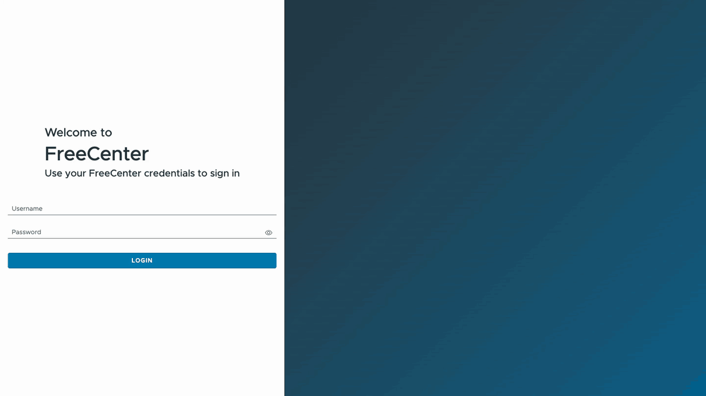
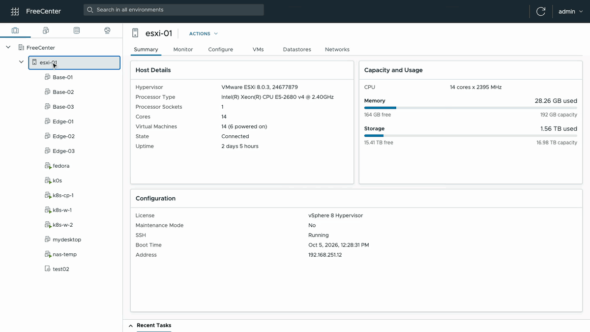
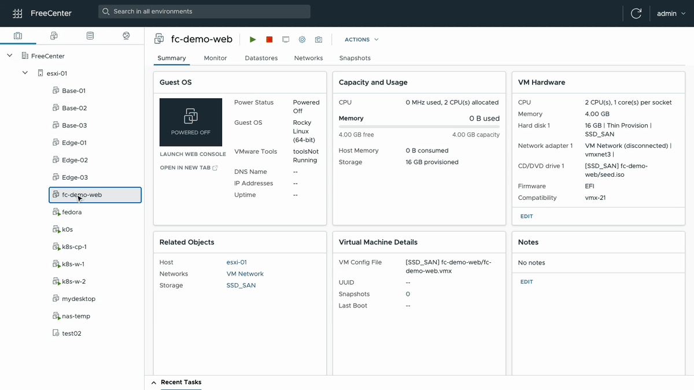
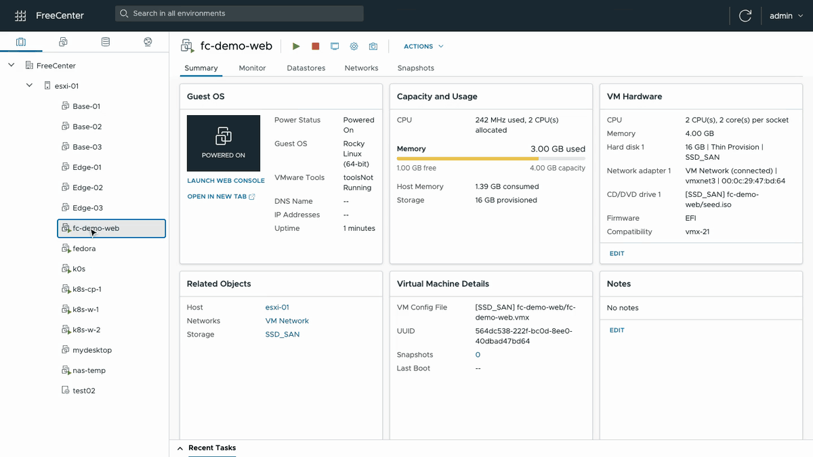

# FreeCenter

**An independent, open-source web console for managing standalone ESXi hosts from one place.**

> FreeCenter is not a VMware or Broadcom product and is not affiliated with, endorsed or supported by them. See [Licensing and compliance](#licensing-and-compliance) and [Trademarks](#trademarks).

## What it is, and what it is not

FreeCenter is a simple user interface, and an API, that wraps the standard administration commands already present on an ESXi host (`vim-cmd`, `esxcli`, `vmkfstools`). Everything it does, an administrator can do by hand in the host's own shell; FreeCenter only saves the typing.

Its purpose is **not** to work around the licensing of vCenter Server or of any other product. It is not a replacement for vCenter Server, it does not unlock licensed features, and it adds nothing to a host that the host does not already offer.

The one practical advantage is automation in a **home lab**: with the REST API and the Terraform provider you can describe machines as code and build throwaway test systems quickly. It is meant for home labs and test environments, not for production.

FreeCenter brings your standalone ESXi hosts together: one web console for all of them, virtual machine lifecycle, templates and clones, migration between hosts, backups, scheduled tasks, monitoring, users and roles, a REST API and a Terraform provider. It runs as a single small container next to your hosts and needs nothing installed on them.



> The demo above runs against a real ESXi 8 host. A higher-quality version is in [`docs/media/freecenter-demo.mp4`](docs/media/freecenter-demo.mp4).

## Why

A standalone ESXi host is a capable hypervisor, but it is managed on its own:

- every host has its own Host Client, and there is no inventory across hosts;
- cloning, templates, backups and moving a machine to another host are manual work;
- where the host's management API only answers queries, automation tools that rely on it cannot create or change anything.

FreeCenter fills that gap for home labs and test environments. It reads the inventory through the host's management API and makes every change over SSH, with the administration tools already present on the host and the administrator credentials you give it. You point it at your hosts and manage everything from one place, by hand or through automation.

## What you can do with it

### One console for all your hosts

- Register any number of ESXi hosts and browse them in a single inventory, with four views: hosts, virtual machines, storage, networking.
- Summary pages for hosts, virtual machines, datastores and networks, with capacity and usage at a glance.
- **Alarms** on the root summary: disk-health conditions (SMART failures, reallocated sectors, over-temperature) across all hosts, refreshed every 10 minutes.
- A **Recent Tasks** panel showing every operation, who started it and how it ended, including the ones started through the API or Terraform.
- Search across all hosts.



### Virtual machines

- **Create** virtual machines with a guided wizard: guest OS, CPU, memory, disks, network, SCSI controller, boot ISO.
- **Deploy from cloud images**: clone a ready-made image (Rocky Linux, Ubuntu, Fedora, Debian: downloadable from a built-in catalog) and let cloud-init set the host name, users, SSH keys and packages on first boot. A new Linux server is ready in about a minute.
- **Edit** everything afterwards: CPU and cores per socket, memory, disks (add, grow, remove, also on other datastores), network adapters, CD/DVD drives, USB controller, firmware (BIOS/EFI), boot delay, CPU and memory hot add, nested virtualization, notes. FreeCenter offers to power the machine off and back on for you when the change requires it.
- **Power** operations: power on and off, reset, suspend, guest shutdown and restart.
- **Web console**: the screen, keyboard and mouse of the machine in your browser, in a floating window you can move and resize while you keep working, or in a tab of its own. Nothing to install, and the browser never needs to reach the host directly.
- **Snapshots**: take, revert, delete, delete all.
- **Clone** a machine, convert it to a **template**, and create new machines from templates.





### Migration between hosts

Move a virtual machine to another host from the **Migrate** dialog. FreeCenter checks compatibility first (CPU, free space, networks) and tells you what will happen:

- a powered-off machine is simply moved;
- between hosts with the same CPU, a running machine is suspended, moved and resumed where it was;
- between hosts with different CPUs, FreeCenter proposes to shut the machine down, move it and start it again on the other side;
- optionally, the disks of a running machine are copied while it keeps running, so the machine is only stopped for the final, short step.

The data travels directly between the two hosts, over a dedicated and restricted channel that FreeCenter sets up for you. If the datastore is shared between the hosts, nothing is copied at all. If anything fails, the machine is brought back on its original host. Details in [docs/migration.md](docs/migration.md).

### Backups and scheduled tasks

- **Back up** a virtual machine while it runs, to any datastore or to another host. A backup is a self-contained, consolidated copy of its disks and configuration.
- **Restore** a backup as a new virtual machine.
- **Schedule** backups and snapshots hourly, daily or weekly, with a retention count: older ones are removed automatically.

### Monitoring

- Real-time charts of CPU, memory, disk and network for hosts and virtual machines, covering the last hour.
- The event log of each host and virtual machine.
- **Disk health**: SMART and NVMe health of every device backing a datastore — overall status, reallocated/pending/uncorrectable sectors, media errors, endurance used and temperature. Compromising values (reallocated sectors, SMART not OK, over-temperature) are shown in red and also surfaced as **alarms** on the root summary, across all hosts. Probed every 10 minutes in the background; a manual refresh is one click away.



### Host configuration

- **Networking**: virtual switches, port groups and VLANs, physical adapters.
- **Services**: start, stop and restart host services and choose which start with the host.
- **Time**: host clock and NTP servers.
- **Maintenance mode**, reboot and shutdown.
- **Datastore browser**: browse, upload and delete files, download ISO images straight to a datastore from a URL, and register a virtual machine that already exists on a datastore.
- A read-only `esxcli` console for quick diagnostics.



### Users and security

- **Local authentication** with username/password, and **OIDC single sign-on** through an external identity provider (e.g. Keycloak). A "Sign in with OIDC" button appears on the login page when an administrator configures it.
- **Granular roles**: administrators define roles with per-area permissions — manage virtual machines, manage hosts, manage storage, manage users, and console access. OIDC groups are mapped to roles, so users get the right permissions automatically when they sign in.
- Host credentials are stored encrypted and are never returned by the API.
- The console and all management traffic go through FreeCenter: users only need access to FreeCenter, not to the hosts.

### Automation

- A complete **REST API**: everything the web console does is available to scripts. See [docs/api.md](docs/api.md).
- A **Terraform provider** to describe hosts, networks, virtual machines, templates, snapshots, backups and schedules as code, including migration between hosts by changing a single attribute. See [terraform-provider-freecenter](https://github.com/fdaforno/terraform-provider-freecenter).

```hcl
resource "freecenter_vm" "web" {
  host_id   = data.freecenter_host.main.id   # change it and the VM migrates
  datastore = "datastore1"
  name      = "web-01"
  guest_id  = "rockylinux_64Guest"

  cloud_image = "cloud-images/rocky-9.vmdk"
  num_cpus    = 2
  memory_mb   = 4096
  network     = "VM Network"

  cloud_init {
    hostname            = "web-01"
    ssh_authorized_keys = [file("~/.ssh/id_ed25519.pub")]
    packages            = ["nginx"]
  }
}
```

## A closer look

| | |
|---|---|
| **Add a host**<br>Register an ESXi host with its address and root credentials; its virtual machines, datastores and networks appear immediately. |  |
| **Deploy a virtual machine**<br>From a cloud image, customized by cloud-init. |  |
| **Use its console**<br>Power on, open the console in a floating window, sign in. |  |
| **Manage it**<br>Snapshots, settings, monitoring, networking. |  |

## Getting started

### Requirements

- One or more hosts running **VMware ESXi 8** (developed and tested on 8.0 U3).
- **SSH enabled** on each host (Host Client: *Manage > Services > TSM-SSH > Start*) and the credentials of `root` or an equivalent user.
- A machine that can reach the hosts on ports 443 and 22, with Docker (or Go and Node.js to build from source).

### Run it

```bash
git clone https://github.com/fdaforno/freecenter.git
cd freecenter
docker build -t freecenter .

docker run -d --name freecenter --restart unless-stopped \
  -p 8080:8080 \
  -v freecenter-data:/data \
  -e FREECENTER_ADMIN_PASSWORD='choose-a-password' \
  freecenter
```

Open `http://<your-machine>:8080`, sign in as `admin` with the password you chose, and add your first host: **Add Host**, then its address and credentials. That is all: the inventory fills in by itself.

Keep the `/data` volume safe: it holds the users, the registered hosts with their encrypted credentials, and the encryption key.

### Good to know

- FreeCenter has no HTTPS of its own. To expose it beyond a trusted network, put it behind a reverse proxy that terminates TLS.
- If you start it without `FREECENTER_ADMIN_PASSWORD`, the initial account is `admin` / `admin` and the console insists that you change it.
- More settings, building from source and the internals are described in [docs/development.md](docs/development.md).

## Limitations

FreeCenter works within what a standalone ESXi host can do:

- Changing the hardware of a virtual machine requires it to be powered off (FreeCenter can do the power cycle for you).
- Disks can grow but not shrink, and not while the machine has snapshots.
- Migration of a running machine is not live: there is a short stop while the machine is suspended or restarted. FreeCenter does not do live migration.
- There are no clusters: no high availability, no automatic load balancing, no distributed switches.
- A machine cannot be moved between two datastores of the same host yet.

## Project layout

| Path | What it is |
|---|---|
| `cmd/`, `internal/` | the FreeCenter server (Go) |
| `web/ui/` | the web console (Angular, [Clarity Design System](https://clarity.design)) |
| `docs/` | API reference, development notes, design notes |

The Terraform provider lives in its own repository: [terraform-provider-freecenter](https://github.com/fdaforno/terraform-provider-freecenter).

## License

[Apache License 2.0](LICENSE). The licenses of the open-source components FreeCenter is built with are listed in [NOTICE](NOTICE).

## Licensing and compliance

FreeCenter is a management client, written from scratch. It contains and distributes no proprietary VMware software; the open-source libraries it is built with are used under their own licenses (see [NOTICE](NOTICE)).

- It connects to your hosts with the credentials you give it and uses only the interfaces and administration tools that the host itself provides.
- It does not patch, modify or replace the hypervisor, and it does not turn on features that a host's license does not include.
- It is not intended to circumvent the licensing of vCenter Server or of any other product: it only runs, on your behalf, the standard commands that the host already provides to its administrator.
- It never changes license keys or licensing settings; it only displays the name of the license a host reports.

You are responsible for making sure that the way you use your hosts, with or without FreeCenter, complies with the license agreement under which you obtained the hypervisor. If you are unsure whether it does, ask the vendor.

## Trademarks

VMware, ESXi, vSphere and vCenter are registered trademarks or trademarks of Broadcom Inc. and/or its subsidiaries. They are used here only to identify the software FreeCenter works with. FreeCenter is an independent project: it is not affiliated with, endorsed, sponsored or supported by Broadcom or VMware.

## Disclaimer

FreeCenter is provided as is, without warranty of any kind. Use it at your own risk, and try it on machines you can afford to lose before trusting it with the ones you cannot.
